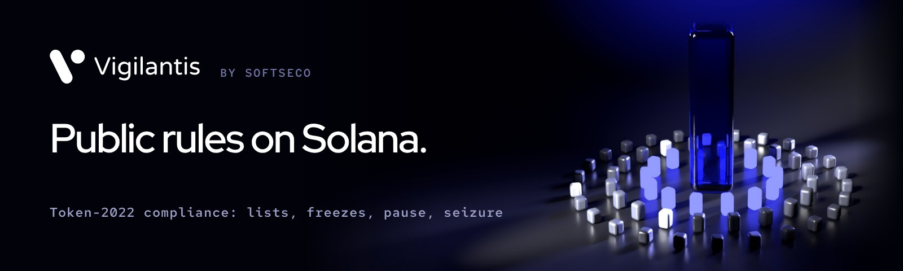

<p align="center"></p>

# Vigilantis

**Programmable compliance for Token-2022 tokenized assets — built on Transfer Hooks.**

Vigilantis attaches compliance rules to a Token-2022 mint so **every transfer is checked on-chain**:
an allowlist, a blocklist (sender, recipient, and a delegate moving someone else's tokens), and a
per-transfer limit — all toggled by a per-mint policy the issuer controls. Regulated and real-world-asset (RWA) tokens can enforce *who*
may hold and move them, without giving up composability.

**Freezing.** A hook can only refuse transfers. When a wallet must be stopped completely
(no transfers in or out, no burns, no approvals, nothing confidential either), the issuer freezes
its token accounts through Vigilantis, which holds the mint's freeze authority. Every block, unblock,
freeze and thaw can carry the issuer's reason code and a case reference, recorded on-chain in an
`EnforcementAction` event, so the record of what was done and why does not depend on anyone's
spreadsheet. The freeze authority can also leave Vigilantis again, to another address or to
no one, and that move is recorded the same way.

**Pause, seizure and roles (1.0).** For an incident, the issuer can pause the whole token: no
transfers, mints or burns until it resumes. Under a court order, it can seize a frozen account's
public balance: Vigilantis burns it, no earlier than 24 hours after the freeze, and keeps a record
open until the case is closed. Nothing is moved to anyone; paying out under the judgment is the
issuer's own step. Both need the mint to be created with Token-2022's Pausable extension and a
permanent delegate, each held by Vigilantis. And the issuer's admin key does not have to do all of
this itself: it can give a compliance officer a role with just the permissions the job needs, for
example freeze but not thaw.

**Confidential transfers.** Token-2022 hides the amount of a confidential transfer from the hook,
which means an amount limit cannot be enforced on one — it is unenforceable, not satisfied. So a
mint that sets `maxTransferAmount` refuses confidential transfers unless its policy also sets
`allowConfidential`, which is the issuer accepting in the open that the limit does not reach them.
The allowlist and blocklist work on addresses, which stay public, so they apply to confidential
transfers exactly as they do to public ones.

> **Status: 1.0.0-rc.1**, the release candidate for an independent audit. Vigilantis continues
> Sentinel 2.3.0 (`@softseco/sentinel`) under a new name. Self-audited, not independently audited.
> Built by Softseco.
>
> **Program ID:** `4DoDFZJmJWYuBx86UqXi3y24GkQ3Cq4nUBHZwDE5PQM5`, Vigilantis's own, on devnet from its first
> deployment there ([docs/deployment.md](./docs/deployment.md)). The program at
> `5fH1jj6XeZC96jPCxKiSb2onAXcs7f4rMeqMmSsP6puD` is Sentinel 2.1.0 and stays as it is.

## Why

Token-2022's **Transfer Hook** extension runs a program on every transfer. Vigilantis turns that hook
into a reusable, configurable **compliance engine**, so issuers don't have to write and audit their
own transfer-gating program. Set a policy once; Vigilantis enforces it on every move of the asset.

## What's here

- **On-chain program** (Rust / Anchor) — the transfer hook + policy, allowlist, blocklist, limit;
  freezing and thawing token accounts, with the reason recorded; pausing the token; seizing a
  frozen account's balance under a court order; roles with chosen permissions; a two-step handover
  of the policy authority (to a multisig, for example); an event for every policy change, every
  enforcement action and every refused transfer. 91 integration tests on a local validator, 13 of them with
  real Token-2022 confidential transfers, where Token-2022 itself calls the hook. CI runs all of
  them on every push, and once a week against the Token-2022 deployed on mainnet.
- **Model-based fuzzing** — [`tests-fuzz/`](./tests-fuzz): random sequences of every instruction,
  transfer, approval, freeze, thaw, pause, seizure and role change in LiteSVM, with the clock moved
  forward, each outcome, the whole state and every enforcement event checked against a model of
  the rules after every step. CI runs a new random set on every push. Next to it, 11 LiteSVM tests
  of roles, pause and seizure, which needs the clock 24 hours ahead.
- **Threat model** — [`docs/threat-model.md`](./docs/threat-model.md): what Vigilantis protects, who
  is trusted, the invariants it keeps, and its known limits.
- **Audit scope** — [`docs/audit-scope.md`](./docs/audit-scope.md): what an auditor reads, how to
  build and test it, and what the hook costs a transfer in compute units and bytes.
- **TypeScript SDK** — [`@softseco/vigilantis`](https://www.npmjs.com/package/@softseco/vigilantis):
  create a compliant mint, manage the policy and entries, freeze and thaw, pause, seize, roles,
  hook-aware transfers, and reads. It installs a `vigilantis` command line for the same operations,
  which can also print each transaction for a multisig to propose.
- **Deployment plan and runbook** — [`docs/deployment.md`](./docs/deployment.md): who holds which
  key, the verified build, deploying and upgrading through a multisig, and what to do in an
  emergency.
- **Runnable demo** — [`sdk/examples/compliant-asset-demo.ts`](./sdk/examples/compliant-asset-demo.ts).

## Quickstart (SDK)

```bash
npm install @softseco/vigilantis
```

```ts
import { VigilantisClient } from "@softseco/vigilantis";

const vigilantis = new VigilantisClient(provider); // AnchorProvider

await vigilantis.createCompliantMint({ mint, decimals: 0 });
await vigilantis.initializePolicy({ mint: mint.publicKey, allowlist: true, blocklist: true, maxTransferAmount: 1000n });
await vigilantis.initializeExtraAccountMetaList(mint.publicKey);
await vigilantis.addToAllowlist(mint.publicKey, investor);
await vigilantis.transfer({ mint: mint.publicKey, destinationOwner: investor, amount: 100n, decimals: 0 });
```

To freeze, create the mint with Vigilantis as its freeze authority (Token-2022 cannot add one later):

```ts
import { ENFORCEMENT_REASONS, caseRef } from "@softseco/vigilantis";

await vigilantis.createCompliantMint({ mint, decimals: 0, freezeAuthority: "vigilantis" });
// ... policy and meta list as above ...
const why = { reasonCode: ENFORCEMENT_REASONS.courtOrder, caseRef: caseRef("CASE-2026-0042", secretSalt) };
await vigilantis.blockAndFreezeWallet(mint.publicKey, suspect, why);
```

To pause and seize as well, create the mint with both extensions held by Vigilantis, and give the
compliance officer a role:

```ts
import { PERMISSIONS } from "@softseco/vigilantis";

await vigilantis.createCompliantMint({ mint, decimals: 0, freezeAuthority: "vigilantis", pausable: true, permanentDelegate: true });
// ... policy and meta list as above ...
await vigilantis.grantRole(mint.publicKey, officer, PERMISSIONS.freeze | PERMISSIONS.pause);
await vigilantis.pause(mint.publicKey, why);   // the whole token, until resume()
await vigilantis.resume(mint.publicKey, why);
// 24 hours or more after the freeze, under a court order:
await vigilantis.seize(mint.publicKey, suspectTokenAccount, why);
```

## Try it in your browser

**[softseco.github.io/arcantis](https://softseco.github.io/arcantis/)** runs a confidential token
with Vigilantis as its transfer hook on devnet, in a browser tab: a confidential payment, then a
blocked wallet, a frozen account and a paused token, each with its reason and case on-chain, then
the auditor's report. Nothing to install. The page lives in the Arcantis repository
([`playground/`](https://github.com/softseco/arcantis/tree/main/playground)).

## Demo

A compliant "ACME" security token, gated live:

```
Terminal 1:  anchor localnet          # validator + deployed program
Terminal 2:  cd sdk && npm install && npm run demo
```

```
✅ Issuer → Alice    500   (allowlisted, within limit)
⛔ Issuer → Carol    500   → recipient not allowlisted
⛔ Issuer → Alice   2000   → exceeds transfer limit
⛔ Issuer → Mallory  100   → recipient sanctioned
✅ Issuer → Alice   2000   (now within the new limit, after a policy update)
```

## Repository layout

```
programs/vigilantis/   on-chain Anchor program
sdk/                 @softseco/vigilantis TypeScript SDK and `vigilantis` CLI (+ examples/)
tests/               integration tests (anchor test)
tests-fuzz/          model-based fuzzing in LiteSVM (cargo test)
docs/                threat model, audit scope, deployment plan and runbook
```

## Status

**1.0.0-rc.1**, continuing Sentinel 2.3.0: program + SDK + demo, 91 integration tests,
11 LiteSVM enforcement tests and model-based fuzzing, self-audited (see [CHANGELOG.md](./CHANGELOG.md) · [SECURITY.md](./SECURITY.md) ·
[threat model](./docs/threat-model.md)). Not independently audited. Preparing for an independent
audit: see the [audit scope](./docs/audit-scope.md). Vigilantis's program ID is
`4DoDFZJmJWYuBx86UqXi3y24GkQ3Cq4nUBHZwDE5PQM5`, on devnet from its first deployment there; Sentinel 2.1.0
runs on devnet at `5fH1jj6XeZC96jPCxKiSb2onAXcs7f4rMeqMmSsP6puD`
since 12 October 2026.

## Local development

```bash
anchor build -- --tools-version v1.57                                   # program
anchor idl build -o sdk/src/idl/vigilantis.json -t sdk/src/idl/vigilantis.ts  # IDL
anchor test --skip-build                                                # 91 integration tests
cd tests-fuzz && cargo test --test enforcement                          # roles, pause, seizure (needs the build)
cd tests-fuzz && cargo test --test model -- --nocapture                 # fuzzing (needs the build)
cd sdk && npm install && npm run build                                  # SDK
```

Requires the Anchor toolchain (0.31.0), Solana CLI, and Node ≥ 20. The `--tools-version` flag is
needed because the default platform-tools build cannot parse Rust edition-2024 dependencies, and
the IDL step is run separately because that flag is not valid there —
see [CONTRIBUTING.md](./CONTRIBUTING.md).

## License

Business Source License 1.1; see [LICENSE](./LICENSE). Testing and development are free for
everyone, and so is using the Vigilantis program Softseco deploys, whatever your size. Any other
production use, such as deploying your own copy of the program, needs a commercial license from
Softseco: write to developers@softseco.com. [COMMERCIAL-LICENSE.md](./COMMERCIAL-LICENSE.md)
says it in plain words. Each version becomes Apache-2.0 four years after its release.
Sentinel, up to 2.3.0, remains available under Apache-2.0 at github.com/softseco/sentinel.
